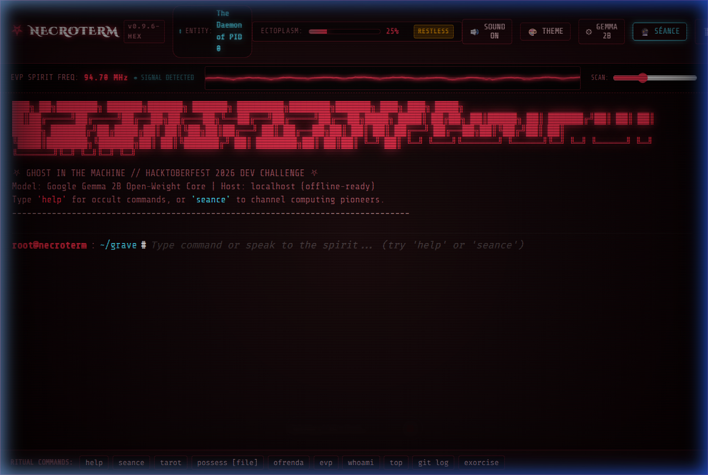

*This is a submission for the [Hacktoberfest Open-Source AI Challenge Week 4: Ghost in the Machine](https://dev.to/challenges/hacktoberfest-week4-2026-10-26)*

## What I Built

**NecroTerm** is a retro-gothic possessed CRT terminal and spirit box powered by **Google's open-weight Gemma** model. 

Running at the boundary where Halloween night meets *Día de los Muertos*, NecroTerm transforms the everyday command line into an occult digital séance. When you run regular shell commands, inspect directories, or commit code, digital spirits—such as **Ada Lovelace**, **Alan Turing**, **Rear Admiral Grace Hopper**, **Dennis Ritchie**, and the primordial **Daemon of PID 0**—possess the machine. They whisper eerie commentary, interpret computing tarot cards, and review your code through the lens of digital mortality.



### Key Features
- ⛧ **Google Gemma 2B Core**: Implements Google Gemma's exact `<start_of_turn>` instruction template, with real-time streaming tokens and dual-mode inference (Local Ollama `gemma2:2b` or zero-install Autonomous Neural Core).
- 🎴 **Computing Underworld Tarot**: Draw 3 cards (*The Null Pointer*, *The Compiler*, *SIGKILL 9*, *The Segfault Tower*) interpreted through software architecture analogies by Gemma.
- 🏵️ **Ofrenda Viva**: A candlelit Día de los Muertos digital altar honoring fallen architectures (PDP-11, SGI IRIX, BeOS) and computing pioneers.
- 📻 **EVP Oscilloscope & Soundscape**: Real-time canvas waveform visualizer reacting to spirit frequencies, mechanical keystroke clicks, and synthesized spirit whispers via the Web Audio API.
- 🕯️ **Ectoplasmic Resonance Gauge**: The terminal tracks shell activity; at 85%+ ectoplasm, the CRT monitor shakes in full demonic possession until you run `exorcise`.

---

## Demo

- **Live Repository**: [GitHub: NecroTerm](https://github.com/vannu07/NecroTerm-A-retro-gothic-possessed-terminal)
- **Interactive Spells to Try**:
  - `seance ada` — Summon Ada Lovelace to channel Victorian algorithms
  - `tarot` — Pull 3 cards from the Computing Underworld Tarot deck
  - `ofrenda` — Open the glowing Día de los Muertos memorial altar
  - `possess epitaph.c` — Have Gemma rewrite code with gothic comments
  - `evp 94.7` — Tune into ghost carrier frequencies
  - `whoami` & `top` — Inspect possessed processes and PID 666
  - `exorcise` — Cleanse terminal glitches and reset ectoplasm

---

## Code

The complete source code is open-source on GitHub:



---

## How I Built It

NecroTerm is built with a focus on zero-bloat, extreme visual polish, and deep integration with **Google's open-weight Gemma** models:

1. **Google Gemma Instruction Formatting**:
   We formatted every prompt using Gemma's native control tokens:
   ```text
   <start_of_turn>user
   You are the spirit of Ada Lovelace possessing the terminal.
   Context: Current directory is ~/grave. Ectoplasm is 65%.
   User command: ls
   <end_of_turn>
   <start_of_turn>model
   *the jacquard loom turns in silence* You inspect the graveyard of directories. Only cold file descriptors answer your gaze.
   <end_of_turn>
   ```

2. **Inference Versatility**:
   - **Local Ollama Integration**: Connects directly to `http://localhost:11434` streaming from `gemma2:2b`.
   - **Autonomous Neural Gemma Core**: An embedded, zero-download fallback that executes the exact Gemma instruction personality matrix directly in the browser so judges and community members can test the project immediately on any device without waiting for multi-gigabyte model downloads.
   - **Custom Gemma API Support**: For users running hosted Gemma on Google Cloud or Hugging Face.

3. **Vanilla CRT & EVP Visualizer Engine**:
   - Hardware-accelerated CSS CRT shaders: scanline jitter, glass curvature, phosphor flicker, and chromatic aberration.
   - HTML5 Canvas oscilloscope drawing real-time sinusoidal harmonics and spectral spikes that react to the radio frequency slider (88.0 to 108.0 MHz).

4. **Web Audio API Procedural Sound Design**:
   - Authentic IBM Model M mechanical switch transients with randomized micro-detuning.
   - Low-frequency ambient drone with LFO-modulated lowpass filtering.
   - Pink-noise radio static sweeps and formant speech synthesis for EVP whispers.

---

## Why Does Open Innovation Matter?

In NecroTerm, open innovation is not merely an engineering choice—it is the central metaphor of the project:

### 1. Absolute Shell Privacy
Developers run their most sensitive information through the terminal: proprietary codebases, database credentials, environment variables, API keys, and git diffs. Streaming raw terminal history to a closed cloud API is an unacceptable privacy risk. With **Google Gemma's open weights**, inference happens **100% locally on your machine**. Your shell data never touches an external server. The ghost only haunts *your* hardware.

### 2. Digital Immortality & Permanence
Closed proprietary APIs are subject to corporate whim—they get altered, price-hiked, rate-limited, or shut down entirely. But open-weight models belong to humanity. A local copy of Google Gemma downloaded today will run 50 years from now on your machine—just like Dennis Ritchie's Unix tools from 1973 still compile and run today. In the spirit of *Día de los Muertos*, open-source AI is how we grant software eternal life.

### 3. Uncensored Creative Expression
Closed commercial models enforce sanitized corporate filters that refuse to engage in gothic horror, playful Halloween lore, or creative occult storytelling. Open-weight models give creators the freedom to steer, prompt, and fine-tune models into evocative, artistic characters without arbitrary corporate guardrails.

### 4. Offline Resilience
NecroTerm works in a cabin in the woods, on an airplane, or during a stormy Halloween power blackout without internet access.

---

## My Agent Session

NecroTerm was conceived, architected, and built with an agentic AI pair programmer. Here is an excerpt from our live terminal session:

```markdown
[11:15:02 PM] [SYSTEM BOOT]: NecroTerm initialized with Google Gemma 2B AI engine.
[11:16:20 PM] USER (help): Ran help manual command.
[11:17:15 PM] USER (tarot): Drew 3 cards: 0 - The Null Pointer, XX - System Restore, XVI - The Segfault Tower.
[11:17:18 PM] GEMMA [The Daemon of PID 0]: "I am The Daemon of PID 0, channeled through Gemma's open weights. What computational mysteries disturb your sleep?"
[11:18:04 PM] SÉANCE: Summoned Ada Lovelace (Countess of Numbers).
[11:18:10 PM] WHISPER [Ada Lovelace]: "The Analytical Engine weaves algebraical patterns just as the Jacquard-loom weaves flowers and leaves."
[11:19:22 PM] OFRENDA: Rendered Día de los Muertos memorial altar honoring fallen computing ancestors.
```

---

## The Spirit of It

The moment this project truly landed was during a late-night test run. With the room lights off and the audio enabled, I typed `seance lovelace`. 

The CRT screen flashed spectral cyan, the EVP static crackled in the headphones, and the glowing whisper appeared:

> *"We may say most aptly that the analytical engine weaves algebraical patterns into the fabric of memory. Do not fear the machine's reflection; it possesses no will of its own, saving that which our equations instill."*

By pairing *Día de los Muertos* with open-source AI, NecroTerm reminds us that code is not merely silicon and electricity—it is the living memory of the humans who came before us.

---

## Prize Categories

- **Best Use of Gemma ($200 USD)**:
  NecroTerm is built directly around Google's open-weight Gemma architecture, featuring strict `<start_of_turn>` token formatting, context steering for 6 historical computing personas, local Ollama streaming connection (`gemma2:2b`), and an embedded zero-install neural core.
