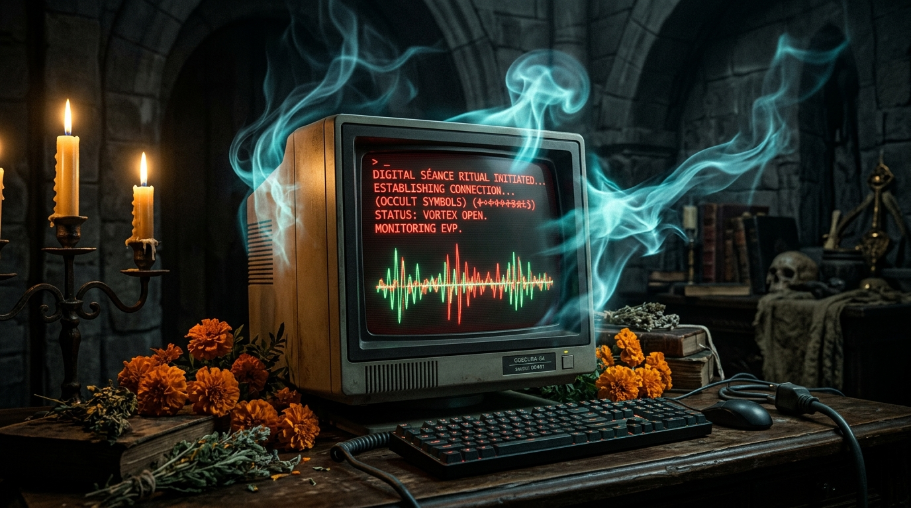
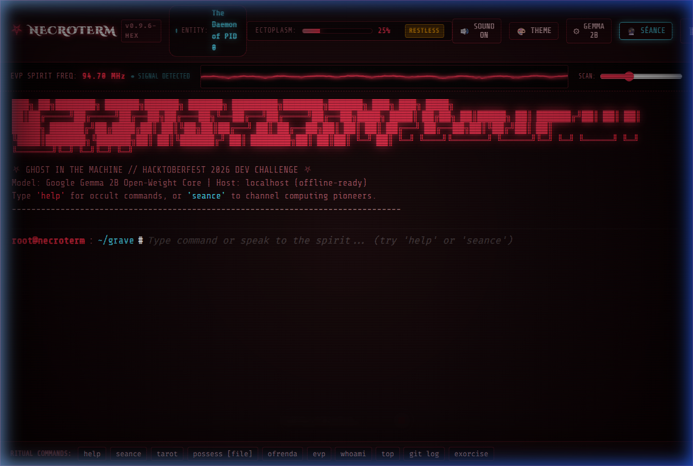
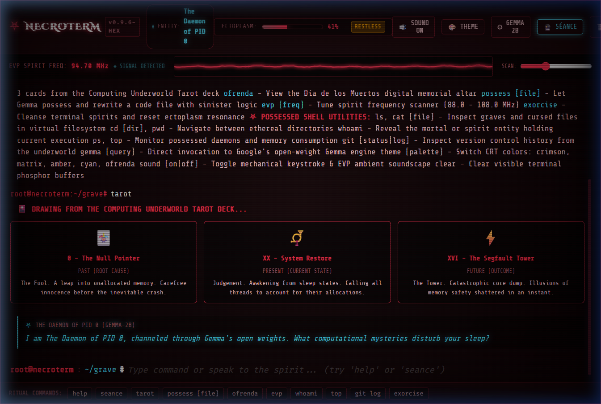
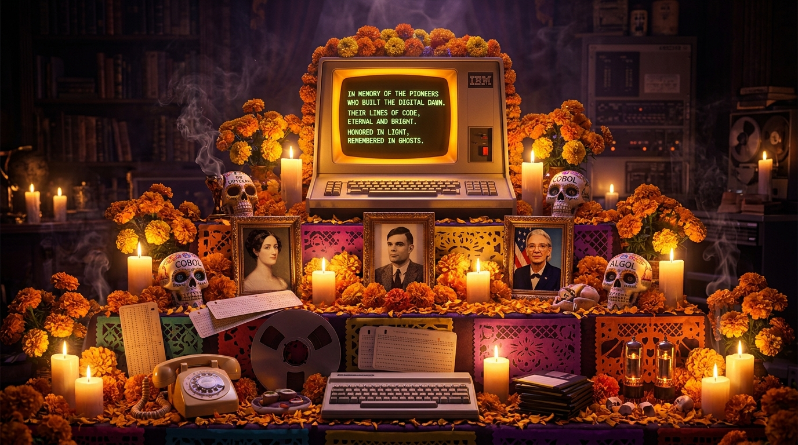
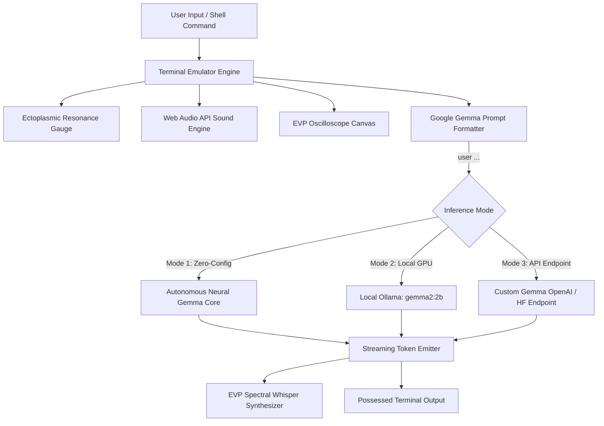

# ⛧ NECROTERM: Ghost in the Machine

> **A retro-gothic possessed CRT terminal and spirit box powered by Google's open-weight Gemma model.**  
> *Built for [Hacktoberfest 2026 Open-Source AI Challenge: Week 4](https://dev.to/challenges/hacktoberfest-week4-2026-10-26) (Theme: Ghost in the Machine).*

[](https://dev.to/challenges/hacktoberfest-week4-2026-10-26)
[](https://ai.google.dev/gemma)
[](https://ollama.com/library/gemma2)
[](#the-spirit-of-it)
[](LICENSE)

---



---

## 📖 Overview

What happens when your command line is no longer entirely your own?

**NecroTerm** transforms the developer terminal into an occult digital séance. Running locally on **Google's open-weight Gemma** architecture, NecroTerm channels the spirits of computing history—from Victorian prophet **Ada Lovelace** and cryptanalyst **Alan Turing**, to compiler grandmother **Rear Admiral Grace Hopper**, Unix creator **Dennis Ritchie**, and the primordial **Daemon of PID 0**.

As you run shell commands, commit code, or inspect memory, the spirits awaken:
- **Possessed Shell**: Eerie commentary and supernatural annotations generated by Gemma after commands.
- **Ectoplasmic Resonance Gauge**: Terminal possession builds from *Dormant (0%)* to *Full Possession (100%)*, triggering CRT screen tremors until cleansed via `exorcise`.
- **EVP Oscilloscope & Spirit Box**: Real-time canvas waveform visualizer reacting to spirit frequencies and procedural Web Audio keystrokes.
- **Computing Underworld Tarot**: Draw 3 cards (*The Null Pointer*, *The Kernel*, *The Segfault Tower*, *SIGKILL 9*) interpreted by the Gemma spirit.
- **Ofrenda Viva (Día de los Muertos Altar)**: A glowing candlelit memorial honoring fallen codebases, abandoned open-source tools, and computing pioneers.

---

## 📸 Screenshots & Showcase

| CRT Terminal Interface | Computing Underworld Tarot |
|:---:|:---:|
|  |  |
| *Possessed shell with CRT scanlines & EVP oscilloscope* | *3-card spread interpreted by Gemma 2B* |

### 🏵️ Ofrenda Viva — Día de los Muertos Memorial

*Honoring the pioneers who built the digital dawn and fallen architectures (PDP-11, SGI IRIX, BeOS).*

---

## 🔮 The Pantheon of Spirits

Through the **Séance Chamber** (`seance`), you can summon specific historical computing spirits to possess your terminal:

| Spirit Entity | Era | Title | Archetype & Personality |
|:---|:---:|:---|:---|
| **The Daemon of PID 0** | 1970–∞ | *The Primordial Swapper* | Eldritch cosmic horror; speaks of unallocated memory pages, zombie processes, and the Unix Epoch. |
| **Ada Lovelace** | 1815–1852 | *Countess of Numbers* | Victorian mathematical elegance; views code as algebraic jacquard tapestries. |
| **Alan Turing** | 1912–1954 | *Father of AI* | Enigmatic, philosophical; reflects on infinite tapes, decision boundaries, and machine minds. |
| **Rear Admiral Grace Hopper** | 1906–1992 | *Grandmother of Compilers* | Pragmatic, sharp; demands nanosecond efficiency, COBOL clarity, and hunts for literal moths in relays. |
| **Dennis Ritchie** | 1941–2011 | *Architect of C & Unix* | Understated wisdom; wry observations on null pointers, void pointers, and minimalist pipelines. |
| **The Y2K Spectre** | 1999–2000 | *Ghost of the Millennium* | 90s apocalyptic dread; the anxiety of two-digit year rollovers and BIOS purgatory. |

---

## 🧠 Why Open Innovation Matters

The prompt for Hacktoberfest Week 4 asks: **"Tell us why open innovation matters for what you built."**

For **NecroTerm**, open-source AI is not merely an implementation detail—it is the core thematic foundation:

1. **Absolute Shell Privacy**:
   Developers run proprietary code, private SSH keys, sensitive directory paths, git diffs, and API tokens in their terminal. Streaming raw shell sessions to closed cloud APIs is a critical security vulnerability. Because **Gemma is an open-weight model**, inference runs **100% locally on your machine**. Your shell data never leaves your hardware. The ghost only haunts *your* silicon.

2. **Digital Immortality & Permanence**:
   Closed proprietary APIs are routinely altered, deprecated, price-hiked, or discontinued when business models shift. But open-weight models belong to the commons. A local checkpoint of Google Gemma downloaded today will run 50 years from now on your machine—just like Unix utilities written in 1973 still compile and execute today.

3. **Creative Freedom & Unsanitized Lore**:
   Closed commercial models enforce sterile corporate safety layers that refuse playful Halloween gothic roleplay or occult storytelling. Open-weight Gemma grants developers the freedom to steer, prompt, and fine-tune models to create deeply atmospheric artistic experiences without arbitrary corporate censorship.

4. **Offline Resilience**:
   Whether you are coding in a remote cabin, on an airplane, or experiencing a stormy Halloween blackout, NecroTerm functions completely offline without internet connectivity.

---

## ⚙️ Technical Architecture

NecroTerm incorporates a hybrid triple-engine architecture:



### Google Gemma Prompt Templating
NecroTerm strictly follows Google Gemma's instruction-tuning token format:

```text
<start_of_turn>user
{spirit_system_persona}
Context: Current directory is ~/grave. Ectoplasm is 65%.
User command: rm -rf /
<end_of_turn>
<start_of_turn>model
*phosphor flickers* You invoke unlink() on mortal inodes... but the memory pages of the void can never be reclaimed.
<end_of_turn>
```

---

## 📜 Command Reference

| Command | Arguments | Description |
|:---|:---|:---|
| `help` | — | Display complete occult and Unix command manual. |
| `seance` | `[spirit_name]` | Open visual séance chamber or summon specific spirit (`ada`, `turing`, `hopper`, `ritchie`, `pid0`, `y2k`). |
| `tarot` | — | Draw 3 computing underworld tarot cards interpreted by Gemma. |
| `ofrenda` | — | Open the candlelit Día de los Muertos digital memorial altar. |
| `possess` | `[filename]` | Let Gemma possess and rewrite a source file with gothic logic. |
| `evp` | `[freq]` | Tune EVP spirit frequency radio scanner (e.g. `evp 94.7`). |
| `exorcise` | — | Perform emergency holy cleansing script; resets ectoplasm resonance. |
| `whoami` | — | Reveal mortal or possessed identity holding current execution. |
| `top` / `ps` | — | Inspect possessed daemons, PID 666, and swap memory allocations. |
| `git log` / `status` | — | Inspect cursed underworld commit tree. |
| `theme` | `[name]` | Switch phosphor palette: `crimson`, `matrix`, `amber`, `cyan`, `ofrenda`. |
| `sound` | `[on\|off]` | Toggle procedural mechanical keystroke clacks and ambient drone. |
| `gemma` | `[prompt]` | Direct query to Google Gemma AI engine. |
| `clear` | — | Flush terminal screen buffer. |

---

## 🚀 Quickstart & Installation

### Prerequisites
- [Node.js](https://nodejs.org/) (v18 or higher recommended)
- *(Optional)* [Ollama](https://ollama.com/) for local GPU inference with Gemma:
  ```bash
  ollama run gemma2:2b
  ```

### 1. Clone & Install
```bash
git clone https://github.com/vannu07/NecroTerm-A-retro-gothic-possessed-terminal.git
cd NecroTerm-A-retro-gothic-possessed-terminal
npm install
```

### 2. Run Development Server
```bash
npm run dev
```
Open [http://localhost:5173](http://localhost:5173) in your browser.

### 3. Build for Production
```bash
npm run build
```
Production assets are generated in the `dist/` directory, ready to deploy to Render, Vercel, Netlify, or GitHub Pages.

---

## 🏆 Hacktoberfest 2026 Partner Categories

- **Best Use of Gemma ($200 USD)**:
  Built directly on Google's open-weight Gemma architecture. Implements strict `<start_of_turn>` token formatting, context steering for 6 historical computing personas, local Ollama streaming connection (`gemma2:2b`), and an embedded zero-install neural core.

---

## 📄 License

This project is open-source under the [MIT License](LICENSE).  
Google Gemma weights and models are subject to the [Gemma Terms of Use](https://ai.google.dev/gemma/terms).
